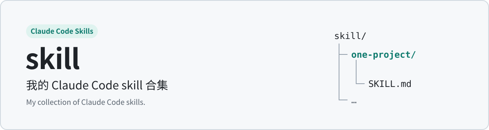

<p align="center">
  
</p>

<p align="center">
  <a href="#skills"></a>
  <a href="https://github.com/3388590759-cloud/skill/releases"></a>
  <a href="LICENSE"></a>
</p>

<p align="center"><a href="README.md">简体中文</a> · <b>English</b></p>

This repository collects the [Claude Code](https://code.claude.com/docs/en/overview) [skills](https://code.claude.com/docs/en/skills) I use and refine in my day-to-day engineering work. Each skill lives in its own folder, so you can browse the source right here on GitHub. Installable packages are published on the [Releases](https://github.com/3388590759-cloud/skill/releases) page.

> [!NOTE]
> The skills themselves are written in Simplified Chinese: their instructions, reference docs and trigger phrases are all in Chinese. Claude understands requests in any language, but the reports and commit messages they produce follow Chinese conventions.

## Skills

| Skill | Summary | Platform | Latest | Download |
|---|---|---|---|---|
| [**one-project**](one-project/README.en.md) | One directory, one project. History lives in git. A Claude Code skill that keeps Keil / STM32CubeMX embedded projects and front-end / back-end projects clean: project hygiene, a standard directory layout (layout v1) and versioning conventions. It can also organize document and asset folders. | Windows | [v1.0.0](https://github.com/3388590759-cloud/skill/releases/tag/one-project-v1.0.0) | [one-project-v1.0.0.skill](https://github.com/3388590759-cloud/skill/releases/download/one-project-v1.0.0/one-project-v1.0.0.skill) |

See each skill's own README for usage, requirements and any extra setup steps.

## Installation

A skill is just a folder containing a `SKILL.md`. Put it in a Claude Code skills directory:

| Location | Scope |
|---|---|
| `%USERPROFILE%\.claude\skills\<skill>\` (i.e. `~/.claude/skills/`) | All projects on this machine |
| `<project>\.claude\skills\<skill>\` | That project only |

### Option 1: download the package (recommended)

1. Download `<skill>-v<version>.skill` from the table above or from [Releases](https://github.com/3388590759-cloud/skill/releases).
2. Rename the extension to `.zip` and extract it. You get a `<skill>` folder. File names inside the package are UTF-8 encoded, so they extract correctly on any system.
3. Move that folder into one of the skills directories above.

Or do it in one go with PowerShell (one-project v1.0.0 as an example):

```powershell
$name = "one-project"; $ver = "1.0.0"
$zip  = "$env:TEMP\$name-v$ver.zip"
Invoke-WebRequest "https://github.com/3388590759-cloud/skill/releases/download/$name-v$ver/$name-v$ver.skill" -OutFile $zip
Expand-Archive $zip "$env:USERPROFILE\.claude\skills" -Force
```

### Option 2: install from source

```powershell
git clone https://github.com/3388590759-cloud/skill.git
Copy-Item -Recurse skill\one-project "$env:USERPROFILE\.claude\skills\"
```

### Check that it works

Restart Claude Code and ask "Which skills can you use right now?". If the skill is in the list, it is installed. Some skills need a one-time setup after installation (for one-project, say 「初始化 one-project」, i.e. "initialize one-project"). See each skill's README.

## Conventions

### Layout

| Path | Contents |
|---|---|
| `<skill>/` | Full source of one skill, identical to the package. `README.md` is the Chinese page, `README.en.md` the English one |
| `assets/` | Banner images used by the READMEs |
| `tools/pack_skill.py` | Builds a release package from a skill folder |
| `LICENSE` | Full text of CC BY-NC-SA 4.0 |

### Versions and releases

- Each skill is versioned independently as `major.minor.patch`: incompatible changes to rules or behavior bump the major version, new features bump the minor version, fixes bump the patch version.
- A release is tagged `<skill>-v<version>` (e.g. `one-project-v1.0.0`) and carries the package `<skill>-v<version>.skill` as an asset.
- What changed in each version is written in the release notes. There is no separate CHANGELOG.
- Machine-specific private files (personal design drafts, local to-do lists) are excluded by `.gitignore`. They never enter the repository or the packages.

### Maintenance workflow

I edit and use the skills in my local install directory, and sync them to this repository when cutting a release:

```powershell
# 1. Sync: local install directory → repository (private files excluded)
robocopy "$env:USERPROFILE\.claude\skills\one-project" ".\one-project" /MIR /XF 设计方案.md 存量迁移.md /XD __pycache__

# 2. Commit and push (commit messages use the Chinese "类型: 描述" format)
git add one-project
git commit -m "优化: one-project ……"
git push

# 3. Package and release (the release tag points at the latest commit on remote main, so push first)
python -X utf8 tools\pack_skill.py one-project 1.0.1
gh release create one-project-v1.0.1 dist\one-project-v1.0.1.skill --title "one-project v1.0.1" --notes "……"
```

After a release, update the version and download link in the [Skills](#skills) table.

## Feedback and contributing

- **Bug reports**: [open an issue](https://github.com/3388590759-cloud/skill/issues/new) with the skill name and version, Claude Code version, OS, what you said to Claude (the trigger phrase), what Claude actually did, and any relevant output. Please redact paths, company names and other private details before pasting logs.
- **Suggestions**: open an issue too, describing the scenario and the behavior you expect.
- **Pull requests**: welcome. If a change alters a skill's behavior, update that skill's `references/` docs and README as well. Commit messages use the Chinese `类型: 描述` format, where 类型 is one of 新增 (feature) / 修复 (fix) / 优化 (improvement) / 重构 (refactor) / 文档 (docs) / 测试 (test) / 构建 (build) / 清理 (cleanup) / 发布 (release). By submitting a contribution you agree to release it under this repository's license.

## License

[CC BY-NC-SA 4.0](LICENSE): you may share and adapt the material, provided you give **attribution**, use it for **non-commercial** purposes only, and distribute adaptations under the **same license**.

© 2026 [3388590759-cloud](https://github.com/3388590759-cloud)
