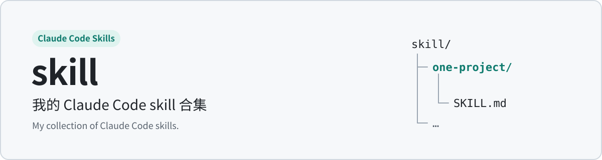

<p align="center">
  
</p>

<p align="center">
  <a href="#skill-列表"></a>
  <a href="https://github.com/3388590759-cloud/skill/releases"></a>
  <a href="LICENSE"></a>
</p>

<p align="center"><b>简体中文</b> · <a href="README.en.md">English</a></p>

这里收录我在日常研发中自用并持续打磨的 [Claude Code](https://code.claude.com/docs/en/overview) [skill](https://code.claude.com/docs/en/skills)。每个 skill 占一个目录，源码可以直接在 GitHub 上浏览；安装包在 [Releases](https://github.com/3388590759-cloud/skill/releases) 下载。

## Skill 列表

| Skill | 简介 | 平台 | 最新版本 | 下载 |
|---|---|---|---|---|
| [**one-project**](one-project/) | 一个目录，一套工程；历史交给 git。工程卫生、目录布局（layout v1）与版本规范管家，面向 Keil / STM32CubeMX 嵌入式和前后端工程，也能整理文档/素材目录。 | Windows | [v1.0.0](https://github.com/3388590759-cloud/skill/releases/tag/one-project-v1.0.0) | [one-project-v1.0.0.skill](https://github.com/3388590759-cloud/skill/releases/download/one-project-v1.0.0/one-project-v1.0.0.skill) |

每个 skill 的用法、环境要求和特有的安装步骤，见它自己目录下的 README。

## 安装

skill 就是一个包含 `SKILL.md` 的文件夹，放进 Claude Code 的 skills 目录即可：

| 放在 | 生效范围 |
|---|---|
| `%USERPROFILE%\.claude\skills\<skill>\`（即 `~/.claude/skills/`） | 本机所有工程 |
| `<工程>\.claude\skills\<skill>\` | 只在该工程里 |

### 方式一：下载安装包（推荐）

1. 在上表或 [Releases](https://github.com/3388590759-cloud/skill/releases) 下载 `<skill>-v<版本>.skill`。
2. 把扩展名改成 `.zip` 解压，得到 `<skill>` 文件夹（包内中文文件名为 UTF-8 编码，任何系统解压都不会乱码）。
3. 把这个文件夹放到上面的 skills 目录下。

也可以用 PowerShell 一步完成（以 one-project v1.0.0 为例）：

```powershell
$name = "one-project"; $ver = "1.0.0"
$zip  = "$env:TEMP\$name-v$ver.zip"
Invoke-WebRequest "https://github.com/3388590759-cloud/skill/releases/download/$name-v$ver/$name-v$ver.skill" -OutFile $zip
Expand-Archive $zip "$env:USERPROFILE\.claude\skills" -Force
```

### 方式二：从源码安装

```powershell
git clone https://github.com/3388590759-cloud/skill.git
Copy-Item -Recurse skill\one-project "$env:USERPROFILE\.claude\skills\"
```

### 确认生效

重开 Claude Code，问一句「你现在能用哪些 skill？」，列表里有它就说明装好了。有的 skill 装好后还要初始化一次（比如 one-project 要说「初始化 one-project」），详见各自的 README。

## 仓库约定

### 目录结构

| 路径 | 内容 |
|---|---|
| `<skill>/` | 一个 skill 的完整源码，内容与安装包一致；`README.md` 是中文介绍页，`README.en.md` 是英文版 |
| `assets/` | README 用到的横幅图 |
| `tools/pack_skill.py` | 把 skill 目录打成 Release 安装包 |
| `LICENSE` | CC BY-NC-SA 4.0 许可证全文 |

### 版本与发布

- 每个 skill 独立编版本号，格式 `主.次.修订`：规则或行为有不兼容变化时升主版本，新增功能升次版本，修正升修订号。
- 发版时打 tag `<skill>-v<版本>`（如 `one-project-v1.0.0`），在对应的 Release 里附上安装包 `<skill>-v<版本>.skill`。
- 每个版本改了什么，写在对应 Release 的说明里，不另设 CHANGELOG。
- 本机私有文件（如个人设计草稿、本机待办清单）由 `.gitignore` 排除，不进仓库，也不会进安装包。

### 维护流程

日常在本机的安装目录里修改和使用 skill，要发版时再同步到仓库：

```powershell
# 1. 同步：本机安装目录 → 仓库（排除本机私有文件）
robocopy "$env:USERPROFILE\.claude\skills\one-project" ".\one-project" /MIR /XF 设计方案.md 存量迁移.md /XD __pycache__

# 2. 提交并推送（提交信息用中文「类型: 描述」）
git add one-project
git commit -m "优化: one-project ……"
git push

# 3. 打包并发布（Release 的 tag 打在远程 main 的最新提交上，所以要先推送）
python -X utf8 tools\pack_skill.py one-project 1.0.1
gh release create one-project-v1.0.1 dist\one-project-v1.0.1.skill --title "one-project v1.0.1" --notes "……"
```

发完版后，记得更新上面「Skill 列表」里的版本号和下载链接。

## 反馈与贡献

- **报告问题**：请[提 Issue](https://github.com/3388590759-cloud/skill/issues/new)，写明 skill 名称和版本、Claude Code 版本、操作系统、你说了什么（触发语）、Claude 实际做了什么，并附上相关输出。贴日志前请把路径、公司名等隐私信息脱敏。
- **提建议**：同样走 Issue，说清使用场景和期望的行为。
- **提交 PR**：欢迎。改变 skill 行为的改动，请同步更新该 skill 的 `references/` 文档和 README；提交信息用中文「类型: 描述」，类型限 新增/修复/优化/重构/文档/测试/构建/清理/发布。提交即表示同意你的贡献按本仓库许可证发布。

## 许可证

[CC BY-NC-SA 4.0](LICENSE)：可以自由分享和改编，但须**署名**、**不得用于商业目的**，改编后的作品须以**相同许可证**发布。

© 2026 [3388590759-cloud](https://github.com/3388590759-cloud)
