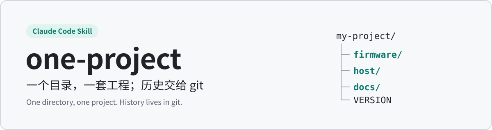
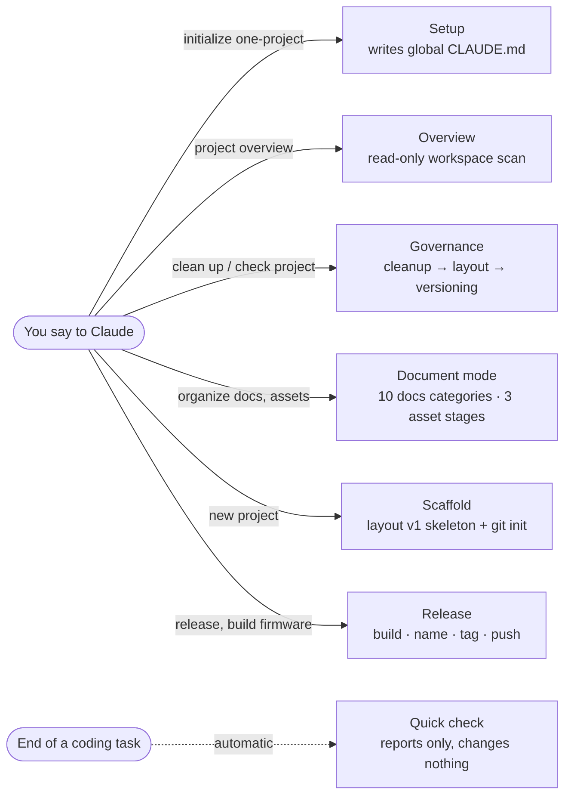
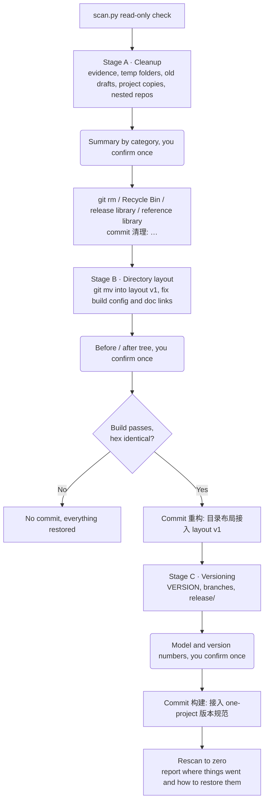

<p align="center">
  
</p>

<p align="center">
  <a href="https://github.com/3388590759-cloud/skill/releases?q=one-project"></a>
  <a href="https://github.com/3388590759-cloud/skill/blob/main/LICENSE"></a>
  
  
  
  <a href="https://code.claude.com/docs/en/skills"></a>
</p>

<p align="center"><a href="README.md">简体中文</a> · <b>English</b></p>

**one-project** is a Claude Code skill that keeps embedded projects (Keil / STM32CubeMX) and front-end / back-end projects on Windows clean. It removes leftover process files and whole-project copies, reorganizes directories into one standard template (layout v1), and puts the project on a `hardware.protocol.firmware` version number, a fixed branch model and a release procedure. It can also organize document and asset folders that don't use git.

Every step shows you a list first and acts only after you confirm. Each stage is committed separately, so anything can be restored.

> [!NOTE]
> The skill is written in Simplified Chinese. Its trigger phrases, reports, folder names (such as `docs/协议/`) and commit messages are all Chinese. The English phrases below are translations; Claude understands either.

> Part of the [skill collection](https://github.com/3388590759-cloud/skill/blob/main/README.en.md).

## Why

After a while, a project folder tends to look like this:

- One topic has `标定方案.md`, `标定方案_v2.md` and `标定方案_v3_final.md` (calibration plan, v2, v3 final), and nobody knows which one counts
- Someone copied the whole project to `TempLogger - 副本` ("TempLogger - Copy") just in case; months later both copies are being edited
- AI assistants leave `.artifacts/`, `evidence/`, screenshots, logs and handover snapshots that keep piling up
- Old hex files sit in `hex历史/` (hex history), and nobody can say which build was actually delivered
- The root is full of `.bat` files, and the PC tool lives in `上位机/` in one project and `PC/` in the next
- Every project writes its version number differently, and task branches like `codex/*` and `feat/*` linger

one-project is built on a few simple rules:

| Rule | Meaning |
|---|---|
| **One directory = one project** | One project directory = one git repository = one working tree = one set of code and outputs for the current branch. Versions differ only in git history (branches / tags). Only specification documents (communication protocols, interface contracts, requirement specs, component datasheets) may keep several versions side by side. |
| **git is the archive** | Tracked process files are simply deleted; history keeps them. Untracked text files are committed first, then deleted. Binaries and large files go to the Recycle Bin. Deliverables go to the release library. The skill itself writes no state files. |
| **One name, one place** | Top-level folders come from a fixed vocabulary. The skeleton is as fixed as a CubeMX-generated project; people only fill content into fixed places. |
| **The scanner reports facts; content decides** | `scan.py` is read-only and stateless. It provides facts and hints. Whether something is a process file, which draft is final, or whether a folder is a copy is decided by Claude after reading the content, and then confirmed by you. |

## Before and after

A fictional temperature logger project (STM32CubeMX firmware + Python PC tool):

**Before**

```text
TempLogger/                       branches: master, codex/fix-modbus
├── TempLogger.ioc
├── Core/  Drivers/  MDK-ARM/     CubeMX project scattered in the root
├── 上位机/                        PC tool: main.py  requirements.txt
├── keilkill.bat
├── run_gui.bat
├── 通信协议_V1.2.md               protocol spec V1.2
├── 通信协议_V1.3.md               protocol spec V1.3
├── 标定方案.md                    calibration plan
├── 标定方案_v2.md
├── 标定方案_v3_final.md
├── 交接说明_0920.md               handover notes
├── hex历史/                       TempLogger_0901.hex  TempLogger_0915.hex
├── evidence/                     截图_0916.png (screenshot)
├── .artifacts/                   verify_0915/serial.log
└── README.md
TempLogger - 副本/                 a full copy of the project "as a backup"
```

**After**

```text
TempLogger/                       branch: main
├── README.md                     with a "directory structure" table
├── VERSION                       model, version 1.103.0, protocol V1.3, layout = 1
├── CLAUDE.md
├── .gitignore
├── firmware/
│   └── TempLogger/               whole CubeMX project; folder name = .ioc name
│       ├── TempLogger.ioc
│       ├── Core/  Drivers/  MDK-ARM/
│       └── User/App/modbus.c     hand-written code moved out of Core/
├── host/                         formerly 上位机/
│   ├── main.py  requirements.txt
│   └── run_gui.bat
├── tools/
│   └── clean_keil.bat            formerly keilkill.bat
├── docs/
│   ├── 协议/                      protocols: 通信协议_V1.2.md  通信协议_V1.3.md
│   └── 方案/                      plans: 标定方案.md (final version only)
└── release/                      current deliverables, not committed
```

Everything that was moved has a destination:

| Before | Where it went |
|---|---|
| `evidence/` (screenshots) | Recycle Bin |
| `.artifacts/`, `交接说明_0920.md` | Untracked text: committed once, then deleted; recoverable from git history |
| `标定方案.md`, `标定方案_v2.md` | `git rm`; the final version is renamed to `docs/方案/标定方案.md` |
| `通信协议_V1.2.md`, `通信协议_V1.3.md` | Specification documents: both versions kept, moved to `docs/协议/` |
| `hex历史/*.hex` | Builds that were actually delivered go to the release library `<release-lib>\TempLogger\`; the rest go to the Recycle Bin |
| `TempLogger - 副本/` | After you confirm its protocol version, it becomes a `protocol/vX.Y-<variant>` branch; once verified, the copy goes to the Recycle Bin |
| `codex/fix-modbus` branch | Already merged, deleted |
| `master` branch | Renamed to `main` |

This happens in three separate commits: cleanup (「清理: …」), layout (「重构: 目录布局接入 layout v1（…）」) and versioning (「构建: 接入 one-project 版本规范（V1.103.0）」).

## What it does

| You say | Mode | What it does | Changes anything? |
|---|---|---|---|
| 初始化 one-project (initialize one-project) | Setup | Checks the environment, asks where your workspace, release library and reference library are, and writes a "project hygiene" section into your global `~/.claude/CLAUDE.md` | Only the global CLAUDE.md, shown to you first |
| 工程总览 (project overview) | Overview | Scans the whole workspace: cleanup items per project, layout and convention issues, suspected cross-project copies, identical protocol documents | No |
| 整理 / 清理 / 体检工程 (clean up / check this project) | Governance | Stage A cleanup → stage B directory layout → stage C versioning, one confirmation and one commit per stage | After you confirm |
| 整理目录 (reorganize directories) | Governance, stage B only | Moves files into layout v1 and commits only if the build still passes | After you confirm |
| 整理文档 / 整理素材 (organize docs / assets) | Document mode | Ten docs categories, three asset stages, unpacking dated asset bundles, hash-based de-duplication, link fixing; removed files go to the Recycle Bin | After you confirm |
| 新建工程 (new project) | Scaffold | Generates a layout v1 skeleton (README, VERSION, CLAUDE.md, .gitignore, script templates) and runs `git init` | After you confirm the components |
| 发布版本 / 出固件 (release / build firmware) | Release | Builds, names deliverables with the version number, copies them to the release library, creates an annotated tag and pushes | Yes |
| (automatically, at the end of a coding task) | Quick check | A check that takes under a second and catches layout regressions and convention issues | No, only reports |

## How it works

What you say decides the mode:



Governance runs in three stages, each one "scan → you confirm → execute → separate commit":



## Demo

After installing and initializing, say 「工程总览」 (project overview) in Claude Code. The reply is in Chinese; translated here:

```text
> 工程总览

● Scanned 3 projects under D:\work (0.4 s, read-only, nothing changed).

  Project              git      Cleanup          Layout       Conventions   VERSION
  TempLogger           master   6 items  528 KB  7 hints      3 items       none
  TempLogger - 副本    no git   7 items  528 KB  7 hints      1 item        none
  PumpCtrl             main     0                layout v1    0             yes

  Suspected copy: TempLogger ↔ TempLogger - 副本 (structure 1.0, content 1.0, strong)
  Same-version protocol docs: protocol V1.2 and V1.3 exist in both folders, identical

  Suggested order:
  1. TempLogger
     · Cleanup: evidence/, .artifacts/, 交接说明_0920.md, 2 hex files in hex历史/
     · 3 rounds of the calibration plan (标定方案.md / _v2 / _v3_final): keep the final one
     · Branches: rename master to main; codex/fix-modbus is merged and can be deleted
     · Layout: move the CubeMX project into firmware/TempLogger/, 上位机/ → host/
     · Conventions: VERSION is missing
  2. TempLogger - 副本: identical to the main project. Confirm which protocol version it
     belongs to, then turn it into a variant branch or send it to the Recycle Bin
  3. PumpCtrl: already on layout v1 and versioned, nothing to do

  To start with TempLogger, say 「整理 TempLogger」.
```

## Installation

**Requirements**

- Windows 10 / 11, Claude Code
- Python 3 (`python` or `py -3`, standard library only)
- git 2.28 or later
- Optional: Keil MDK (`UV4.exe`), STM32CubeMX

macOS and Linux are not supported: Recycle Bin deletion, the `.bat` templates and Keil builds all depend on Windows.

**Steps**

1. Download [one-project-v1.0.0.skill](https://github.com/3388590759-cloud/skill/releases/download/one-project-v1.0.0/one-project-v1.0.0.skill), rename it to `.zip`, extract it, and put the `one-project` folder into `%USERPROFILE%\.claude\skills\`. For a one-line PowerShell install or installing from source, see the [collection page](https://github.com/3388590759-cloud/skill/blob/main/README.en.md#installation).
2. Restart Claude Code and say 「初始化 one-project」 (initialize one-project). It checks your environment, asks where your projects, release library and reference library live, and writes a "project hygiene (one-project)" section into your global `~/.claude/CLAUDE.md`, showing it to you before writing.
3. Say 「工程总览」 (project overview) to try it.

> [!IMPORTANT]
> Do not skip step 2. The everyday rules (no worktrees, no process files inside projects, branch and commit formats, the end-of-task quick check) all come from that section of the global CLAUDE.md. If you only copy the folder without initializing, none of them take effect.

**Upgrading**

Extract the new package over the `one-project` folder. `references/存量迁移.md` is your machine's own to-do list; it is not in the package, so overwriting leaves it alone. If you delete the whole folder to reinstall, back that file up first.

**Self-test**

```powershell
python -X utf8 tests\test_scan.py --sandbox <an empty or non-existent directory>
```

## Conventions at a glance

| Topic | Rule | Details (Chinese) |
|---|---|---|
| Version | `hardware.protocol.firmware`, where protocol = major × 100 + minor, e.g. `V2.110.3 (protocol V1.10)`. The `VERSION` file in the project root is the single source. A version is frozen once tagged; any later change bumps the firmware number | [版本与发布](references/版本与发布.md) |
| Branches | Only `main`, `protocol/vX.Y` and `protocol/vX.Y-<variant>`; no task branches such as `codex/*` or `feat/*` | [版本与发布 §4](references/版本与发布.md#4-分支与-tag) |
| Commits | Chinese `类型: 描述` (type: description), with 9 types: 新增 feature, 修复 fix, 优化 improvement, 重构 refactor, 文档 docs, 测试 test, 构建 build, 清理 cleanup, 发布 release | [版本与发布 §5](references/版本与发布.md#5-提交信息) |
| Deliverables | `<model>[-<component>]_V<version>[_<variant>].<ext>`, e.g. `ABC-200_V1.104.2.hex`; the current one in `release/`, official ones also copied to the release library | [版本与发布 §7](references/版本与发布.md#7-发布流程) |
| Top-level folders | Fixed vocabulary: `firmware/ host/ server/ web/ app/ deploy/ contracts/ tools/ tests/ docs/ release/`; no scripts in the root | [目录布局](references/目录布局.md) |
| Inside firmware | The whole CubeMX project in `firmware/<board>/`; hand-written code in `User/App`, `User/BSP`, `User/ThirdParty` | [目录布局 §4](references/目录布局.md#4-组件内规则) |
| Documents | `docs/` has ten categories: protocols, interfaces, requirements, references, plans, issue records, logs, manuals, reports, templates (folder names in Chinese). Update a topic in place; no `-v2` or `-final` copies | [文档整理](references/文档整理.md) |
| Process files | Verification evidence, AI temp folders, old release packages and build logs, handover snapshots, old drafts, whole-project copies, nested repositories | [判定规则](references/判定规则.md) |

## Safety rules

In every mode, one-project never crosses these lines:

- No worktrees, no copies of the project directory
- One-off process files go to the session scratchpad, never to new `.artifacts/`, `evidence/` or `tmp/` folders inside the project
- Commits `git add` only the exact paths on the agreed list, never your other changes
- Never force-push, never rewrite pushed history
- Untracked files only go to the Recycle Bin; anything too large for the Recycle Bin (and therefore permanently deleted) must be called out in the summary and approved by you
- The release and reference libraries are append-only; if a target exists with different content, it stops and asks
- Decisions are based on build configuration, references and content; file names are only hints. Normal build outputs are never touched
- CubeMX projects are never regenerated just to reorganize them; you are reminded to close Keil / your IDE before files are moved

The full list is in [SKILL.md §7](SKILL.md#7-底线任何模式都不可违反) (Chinese).

## FAQ

<details>
<summary><b>My project isn't embedded. Can I still use it?</b></summary>

Yes. Front-end / back-end projects are organized into `server/`, `web/` and `app/` components. Node / .NET workspace projects (monorepos, `*.sln`) are left alone inside; only `deploy/ tools/ docs/ release/` and the root are managed. The hardware part of the version number is 0; the protocol part follows the device protocol the software talks to, or 0 if it talks to none.

</details>

<details>
<summary><b>My project isn't under git yet.</b></summary>

Before any cleanup, it offers to assemble a `.gitignore` for your toolchain, run `git init` and commit a baseline of the current state. Cleanup continues only after you agree, so the original state can always be recovered from history.

</details>

<details>
<summary><b>I don't want git for a documents / assets folder.</b></summary>

Put a `VERSION` file in the folder root with `type = docs`. It is then handled as a document project: no `git init`, removed files only go to the Recycle Bin, and before anything moves a manifest (with SHA-256 hashes) is written to the scratchpad so files can be moved back if needed.

</details>

<details>
<summary><b>Could it delete the wrong thing?</b></summary>

The scanner is read-only. Every category of action is summarized for your confirmation, and anything uncertain is asked about one by one. Tracked files are removed with `git rm` and can be restored with `git checkout <commit>^ -- <path>`; untracked files go to the Recycle Bin. Every run ends with a report of where things went and how to restore them.

</details>

<details>
<summary><b>Could reorganizing break my firmware?</b></summary>

Stage B builds once before moving anything to record a baseline. Afterwards the build must pass, and for pure moves the firmware hex must be byte-identical; otherwise nothing is committed and everything is restored. New groups in the uvprojx are inserted where the original files were, so the link order stays the same.

</details>

<details>
<summary><b>Does the scanner go online or upload code?</b></summary>

No. `scripts/scan.py` uses only the Python standard library, runs no programs other than local git, and makes no network calls.

</details>

<details>
<summary><b>I have my own folder habits and the vocabulary isn't enough.</b></summary>

A new purpose is first mapped to an existing name. If it truly doesn't fit, Claude asks you, spelling out "meaning / what goes in / what doesn't". Once you approve, both `LAYOUT_V1` in `scan.py` and the layout document are updated, shared by all projects. There are no per-project private names.

</details>

<details>
<summary><b>Why Windows only?</b></summary>

Deletion goes through the Windows Recycle Bin, the script templates are `.bat`, and firmware builds rely on Keil. All of these are tied to Windows.

</details>

## License

[CC BY-NC-SA 4.0](https://github.com/3388590759-cloud/skill/blob/main/LICENSE): you may share and adapt it with attribution, for non-commercial purposes only, and adaptations must use the same license. Questions and suggestions are welcome as [issues in the collection repository](https://github.com/3388590759-cloud/skill/issues).
