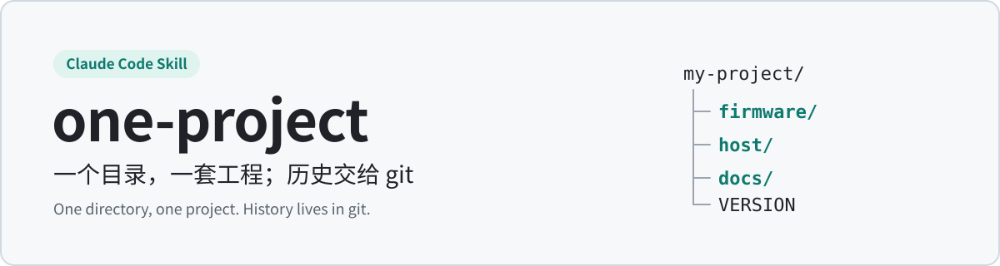
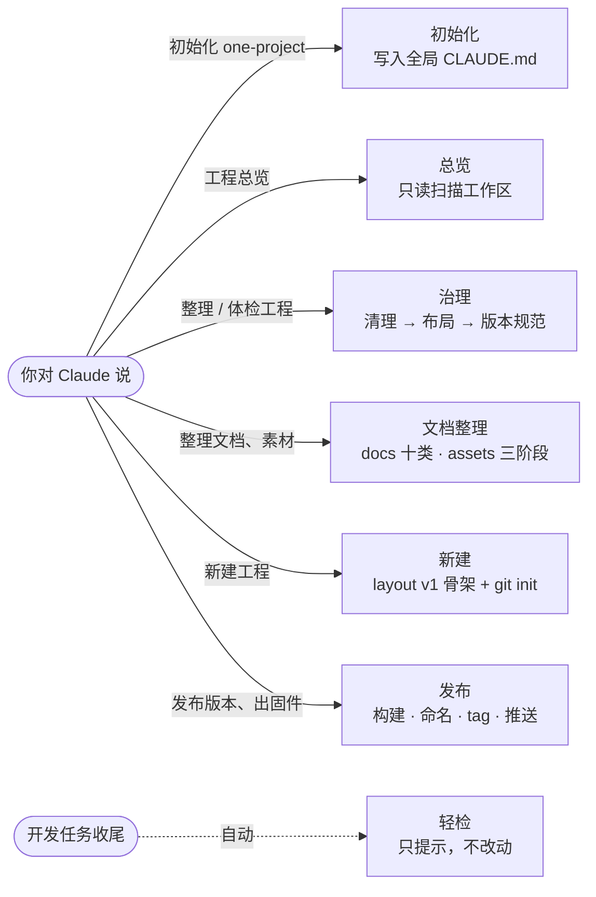
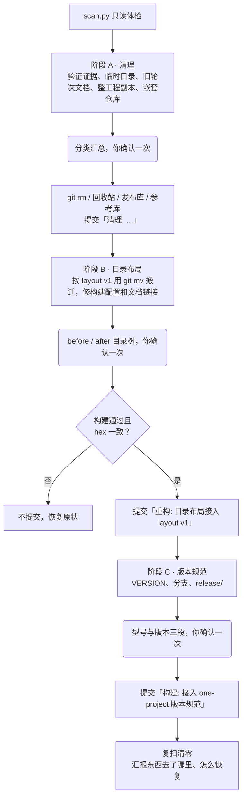

<p align="center">
  
</p>

<p align="center">
  <a href="https://github.com/3388590759-cloud/skill/releases?q=one-project"></a>
  <a href="https://github.com/3388590759-cloud/skill/blob/main/LICENSE"></a>
  
  
  
  <a href="https://code.claude.com/docs/en/skills"></a>
</p>

<p align="center"><b>简体中文</b> · <a href="README.en.md">English</a></p>

**one-project** 是一个 Claude Code skill，用来把 Windows 上的嵌入式（Keil / STM32CubeMX）工程和前后端工程管干净：清理过程文件和整工程副本，按统一的 layout v1 模板整理目录，再接入 `硬件.协议.固件` 版本号、分支和发布规范。不用 git 的文档/素材目录也能整理。

每一步都先给你看清单，确认后才动手；每个阶段单独提交，随时可以恢复。

> 属于 [skill 合集](https://github.com/3388590759-cloud/skill)。

## 为什么需要它

工程目录用久了，往往会变成这样：

- 同一个主题躺着 `标定方案.md`、`标定方案_v2.md`、`标定方案_v3_final.md`，没人说得清哪份算数
- 为了"保险"把整个工程复制一份 `TempLogger - 副本`，几个月后两份都有人在改
- AI 助手留下的 `.artifacts/`、`evidence/`、截图、日志和交接快照越堆越多
- 历史 hex 散落在 `hex历史/`，说不清哪一版真正交付过
- 根目录堆满 `.bat`，上位机目录这个工程叫 `上位机/`、那个工程叫 `PC/`
- 版本号各写各的，分支里混着 `codex/*`、`feat/*` 这类任务分支

one-project 背后是几条简单的约定：

| 约定 | 含义 |
|---|---|
| **一个目录 = 一套工程** | 一个工程目录 = 一个 git 仓库 = 一份工作区 = 当前分支的一套代码和产物。版本差异只存在于 git 历史（分支 / tag）。只有规范本体文档（通信协议、接口契约、需求规格、器件规格书）可以多版本并存。 |
| **git 即档案** | 已跟踪的过程文件直接删，历史里随时取回；未跟踪的文本先提交再删；二进制和大件进回收站；交付物进发布库。skill 本身不写任何状态文件。 |
| **一类东西一个名字、一个位置** | 顶层目录只用固定词表，骨架像 CubeMX 生成的工程一样固定，人只往固定位置填内容。 |
| **扫描给事实，判断靠内容** | `scan.py` 只读、无状态，只提供事实和线索；"是不是过程文件、哪份是最终版、是不是副本"由 Claude 打开内容判断，再交给你确认。 |

## 整理前后

以一个虚构的温度记录仪工程（STM32CubeMX 固件 + Python 上位机）为例：

**整理前**

```text
TempLogger/                       分支：master、codex/fix-modbus
├── TempLogger.ioc
├── Core/  Drivers/  MDK-ARM/     CubeMX 工程散在根目录
├── 上位机/                        main.py  requirements.txt
├── keilkill.bat
├── run_gui.bat
├── 通信协议_V1.2.md
├── 通信协议_V1.3.md
├── 标定方案.md
├── 标定方案_v2.md
├── 标定方案_v3_final.md
├── 交接说明_0920.md
├── hex历史/                       TempLogger_0901.hex  TempLogger_0915.hex
├── evidence/                     截图_0916.png
├── .artifacts/                   verify_0915/serial.log
└── README.md
TempLogger - 副本/                 整个工程复制的"备份"
```

**整理后**

```text
TempLogger/                       分支：main
├── README.md                     含「目录结构」表
├── VERSION                       型号、版本 1.103.0、协议 V1.3、layout = 1
├── CLAUDE.md
├── .gitignore
├── firmware/
│   └── TempLogger/               CubeMX 工程整体搬入，目录名 = .ioc 名
│       ├── TempLogger.ioc
│       ├── Core/  Drivers/  MDK-ARM/
│       └── User/App/modbus.c     自写代码移出 Core/
├── host/                         原 上位机/
│   ├── main.py  requirements.txt
│   └── run_gui.bat
├── tools/
│   └── clean_keil.bat            原 keilkill.bat
├── docs/
│   ├── 协议/                      通信协议_V1.2.md  通信协议_V1.3.md
│   └── 方案/                      标定方案.md（只留最终版）
└── release/                      当前交付物，不入库
```

移走的东西都有去处：

| 原来的 | 去向 |
|---|---|
| `evidence/`（截图） | 回收站 |
| `.artifacts/`、`交接说明_0920.md` | 未跟踪的文本，先提交存档再删除，随时可从 git 历史取回 |
| `标定方案.md`、`标定方案_v2.md` | `git rm`；最终版改名为 `docs/方案/标定方案.md` |
| `通信协议_V1.2.md`、`通信协议_V1.3.md` | 规范本体，两版都保留，归入 `docs/协议/` |
| `hex历史/*.hex` | 真正交付过的进发布库 `<发布库>\TempLogger\`，其余进回收站 |
| `TempLogger - 副本/` | 确认它对应的协议版本后转为 `protocol/vX.Y-<变体>` 分支，核对无误后副本目录进回收站 |
| `codex/fix-modbus` 分支 | 已合入主线，删除 |
| `master` 分支 | 改名为 `main` |

以上分三次独立提交：「清理: …」「重构: 目录布局接入 layout v1（…）」「构建: 接入 one-project 版本规范（V1.103.0）」。

## 能做什么

| 你说 | 模式 | 它做什么 | 会不会改东西 |
|---|---|---|---|
| 初始化 one-project | 初始化 | 检查环境，问清工作区根、发布库和参考库，把「工程卫生」规则写进全局 `~/.claude/CLAUDE.md` | 只写全局 CLAUDE.md，写前先给你看 |
| 工程总览、扫一下所有工程 | 总览 | 扫描整个工作区：各工程待清理项、布局与规范问题、跨工程疑似副本、同版本协议文档 | 不改 |
| 整理 / 清理 / 体检工程 | 治理 | 阶段 A 清理 → 阶段 B 目录布局 → 阶段 C 版本规范，每阶段确认一次、独立提交 | 确认后才改 |
| 整理目录、规范目录结构 | 治理（只跑阶段 B） | 按 layout v1 搬迁，构建验证通过才提交 | 确认后才改 |
| 整理文档、整理素材 | 文档整理 | docs 十类、assets 三阶段、拆素材包、哈希去重、修链接；移出的文件进回收站 | 确认后才改 |
| 新建工程、脚手架 | 新建 | 按 layout v1 生成骨架（README、VERSION、CLAUDE.md、.gitignore、脚本模板）并 `git init` | 确认组件组合后 |
| 发布版本、出固件 | 发布 | 构建、交付物按版本号命名、复制到发布库、打附注 tag 并推送 | 是 |
| （开发任务收尾时自动触发） | 轻检 | 不到 1 秒的快速检查，拦下布局回退和规范问题 | 不改，只提示 |

## 工作流程

说的话决定进入哪个模式：



治理模式的三个阶段，每个阶段都是「扫描 → 你确认 → 执行 → 独立提交」：



## 使用演示

装好并初始化后，在 Claude Code 里说「工程总览」：

```text
> 工程总览

● 扫描了 D:\work 下的 3 个工程（0.4 秒，只读，没有改动任何文件）。

  工程                 git      清理项          布局        规范项   VERSION
  TempLogger           master   6 项  528 KB    7 项建议    3 项     无
  TempLogger - 副本    非 git   7 项  528 KB    7 项建议    1 项     无
  PumpCtrl             main     0               layout v1   0        有

  跨工程疑似副本：TempLogger ↔ TempLogger - 副本（结构重合 1.0，内容重合 1.0，强）
  同版本协议文档：通信协议 V1.2、V1.3 在两个目录里各有一份，内容一致

  建议的治理顺序：
  1. TempLogger
     · 清理：evidence/、.artifacts/、交接说明_0920.md、hex历史/ 下 2 个 hex
     · 标定方案有 3 轮（标定方案.md / _v2 / _v3_final），只留最终版
     · 分支：master 改名为 main；codex/fix-modbus 已合入主线，可删除
     · 布局：CubeMX 工程整体移入 firmware/TempLogger/，上位机/ → host/
     · 规范：缺少 VERSION
  2. TempLogger - 副本：与主工程完全一致。先确认它对应哪个协议版本，
     再决定转为变体分支，还是直接进回收站
  3. PumpCtrl：已接入 layout v1 和版本规范，无需处理

  要从 TempLogger 开始的话，说「整理 TempLogger」。
```

## 安装

**环境要求**

- Windows 10 / 11，Claude Code
- Python 3（`python` 或 `py -3` 均可，只用标准库）
- git 2.28 及以上
- 按需：Keil MDK（`UV4.exe`）、STM32CubeMX

不支持 macOS / Linux：回收站删除、`.bat` 模板和 Keil 构建都依赖 Windows。

**步骤**

1. 下载 [one-project-v1.0.0.skill](https://github.com/3388590759-cloud/skill/releases/download/one-project-v1.0.0/one-project-v1.0.0.skill)，把扩展名改成 `.zip` 解压，将里面的 `one-project` 文件夹放到 `%USERPROFILE%\.claude\skills\` 下。PowerShell 一键安装和从源码安装的方法见[合集首页](https://github.com/3388590759-cloud/skill#安装)。
2. 重开 Claude Code，说「初始化 one-project」。它会检查环境，问你工程放在哪、发布库和参考库放哪，然后把一节「工程卫生（one-project）」规则写进全局 `~/.claude/CLAUDE.md`，写之前先给你看。
3. 说「工程总览」试一下。

> [!IMPORTANT]
> 第 2 步不能省。日常开发时不建 worktree、过程文件不进工程、分支和提交格式、收尾轻检，都靠全局 CLAUDE.md 里的这一节约束；只放文件夹不初始化，这些都不会生效。

**升级**

解压新版安装包，覆盖 `one-project` 文件夹即可。`references/存量迁移.md` 是你本机的待办清单，安装包里没有这个文件，覆盖不会动它；如果要整个文件夹删掉重装，先把它备份出来。

**自测**

```powershell
python -X utf8 tests\test_scan.py --sandbox <一个空目录或不存在的目录>
```

## 规范速览

| 项 | 规则 | 细则 |
|---|---|---|
| 版本号 | `硬件.协议.固件`，协议段 = 主版本 × 100 + 次版本，例如 `V2.110.3（协议 V1.10）`；以工程根目录 `VERSION` 为准；tag 打出后该版本冻结，之后改动固件段 +1 | [版本与发布](references/版本与发布.md) |
| 分支 | 只有 `main`、`protocol/vX.Y`、`protocol/vX.Y-<变体>`；不建 `codex/*`、`feat/*` 等任务分支 | [版本与发布 §4](references/版本与发布.md#4-分支与-tag) |
| 提交信息 | 中文 `类型: 描述`，类型限 新增 / 修复 / 优化 / 重构 / 文档 / 测试 / 构建 / 清理 / 发布 | [版本与发布 §5](references/版本与发布.md#5-提交信息) |
| 交付物 | `<型号>[-<组件>]_V<版本>[_<变体>].<扩展名>`，如 `ABC-200_V1.104.2.hex`；当前版本放 `release/`，正式版本复制进发布库 | [版本与发布 §7](references/版本与发布.md#7-发布流程) |
| 顶层目录 | 固定词表：`firmware/ host/ server/ web/ app/ deploy/ contracts/ tools/ tests/ docs/ release/`；根目录不放脚本 | [目录布局](references/目录布局.md) |
| 固件内部 | CubeMX 工程整体放 `firmware/<板目录>/`，自写代码进 `User/App`、`User/BSP`、`User/ThirdParty` | [目录布局 §4](references/目录布局.md#4-组件内规则) |
| 文档 | `docs/` 分十类：协议、接口、需求、参考资料、方案、问题记录、记录、手册、报告、模板；同主题原地更新，不建 `-v2`、`-final` 副本 | [文档整理](references/文档整理.md) |
| 过程文件 | 验证证据、AI 临时目录、历史发布包与构建日志、交接快照、旧轮次文档、整工程副本、嵌套仓库 | [判定规则](references/判定规则.md) |

## 安全底线

无论哪个模式，one-project 都不会越过这些线：

- 不建 worktree，不复制工程目录
- 一次性过程文件写到会话 scratchpad，不在工程里新建 `.artifacts/`、`evidence/`、`tmp/`
- 提交只 `git add` 清单里的精确路径，绝不夹带你的其他改动
- 永不 force push，永不改写已推送的历史
- 未跟踪的文件只进回收站；超过回收站容量、会被永久删除的，必须在汇总里写明并经你同意
- 发布库和参考库只增不改，目标已存在且内容不同就停下来问
- 判定依据是构建配置、引用关系和内容，文件名只作线索；正常编译产物不碰
- CubeMX 工程不会为了整理而重新生成代码；搬迁前提醒你关闭 Keil / IDE

完整清单见 [SKILL.md §7](SKILL.md#7-底线任何模式都不可违反)。

## 常见问题

<details>
<summary><b>我的工程不是嵌入式，能用吗？</b></summary>

能。前后端工程按 `server/`、`web/`、`app/` 组件归位，Node / .NET 工作区型工程（monorepo、`*.sln`）内部不动，只管 `deploy/ tools/ docs/ release/` 和根目录。版本号的硬件段填 0；协议段跟它对接的设备协议走，不对接设备的填 0。

</details>

<details>
<summary><b>工程还没用 git 怎么办？</b></summary>

治理前会提议按工具链拼好 `.gitignore`，`git init` 后提交一次「现状基线」。你同意之后才继续清理，所以清理前的样子永远能从历史里找回来。

</details>

<details>
<summary><b>文档、素材目录不想用 git？</b></summary>

在目录根放一个 `VERSION`，写上 `type = docs`，就会按文档型工程处理：不 `git init`，移出的文件只进回收站，搬迁前在 scratchpad 里写好留底清单（含 SHA-256），出问题可以按清单搬回。

</details>

<details>
<summary><b>会不会删错东西？</b></summary>

扫描器只读。每一类处置都先汇总给你确认，拿不准的逐个问。已跟踪的文件用 `git rm` 删除，可以用 `git checkout <提交>^ -- <路径>` 恢复；未跟踪的进回收站。每次结束都会汇报东西去了哪里、怎么恢复。

</details>

<details>
<summary><b>整理目录会不会把固件搞坏？</b></summary>

阶段 B 搬迁前先构建一次留下基线；搬迁后必须构建通过，纯搬迁的固件 hex 必须逐字节一致，否则不提交并恢复原状。uvprojx 里新增的分组会插在原文件所在位置，保证链接顺序不变。

</details>

<details>
<summary><b>扫描器会联网或上传代码吗？</b></summary>

不会。`scripts/scan.py` 只用 Python 标准库，除了调用本地 git 不启动其他程序，也不联网。

</details>

<details>
<summary><b>我已经有自己的目录习惯，词表不够用怎么办？</b></summary>

新用途先尝试归入已有的词；实在归不进，Claude 会问你，写清「含义 / 放什么 / 不放什么」，你批准后同时更新 `scan.py` 的 `LAYOUT_V1` 和目录布局文档，所有工程共用，不设工程私有的词。

</details>

<details>
<summary><b>为什么只支持 Windows？</b></summary>

删除走 Windows 回收站，脚本模板是 `.bat`，固件构建依赖 Keil，这些都绑定 Windows。

</details>

## 许可证

[CC BY-NC-SA 4.0](https://github.com/3388590759-cloud/skill/blob/main/LICENSE)：可以自由分享和改编，须署名、不得用于商业目的、改编后以相同许可证发布。问题和建议请在[合集仓库提 Issue](https://github.com/3388590759-cloud/skill/issues)。
